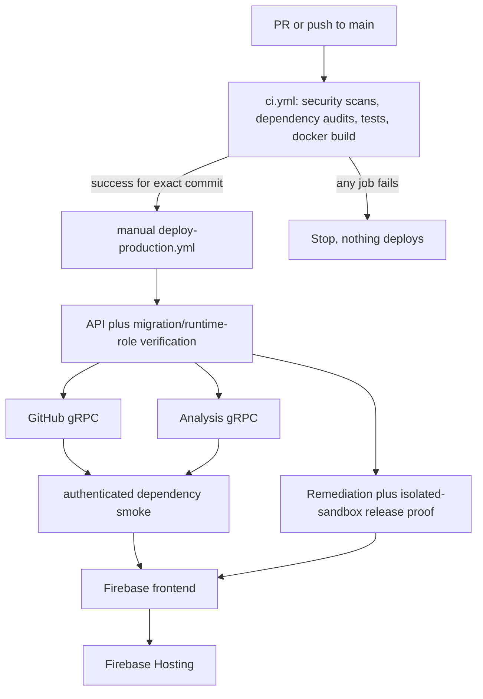

# CI/CD Pipeline

How code goes from a push to running in production. This is the high-level overview; for deploy mechanics (secrets, env vars, targets) see [Cloud Run and Firebase](./cloud-run-firebase.md).

## Overview

The pipeline has two stages:

1. **CI** (`.github/workflows/ci.yml`): the gate. Tests and security scans run on every PR and every push to `main`. Nothing is deployed here.
2. **Deploy**: one ordered production orchestrator, one ordered staging orchestrator,
   and reusable/manual component workflows. Production is manual and requires successful
   CI for the exact commit. Staging starts only after successful CI on a `staging` push.

The ordered release deploys every component from the same immutable commit. Cloud Run
deploys use per-environment concurrency, so repeat deploys are serialized.

## Stage 1: CI (the gate)

`ci.yml` triggers on any PR and any push to `main`. Every job runs in parallel, and **all must pass** or nothing deploys.

| Job | Purpose |
|---|---|
| `security-gitleaks` | Scans git history for leaked secrets. |
| `dependency-review` | PR-only. Flags newly added libraries with known high-severity vulnerabilities. |
| `frontend-checks` | Frontend: install, lint, test, build. |
| `api-tests` | API service: install, lint, test, migration verification. |
| `github-service-tests` | GitHub service: install, lint, test. |
| `analysis-tests` | Analysis service (Python): install, bandit, pytest. |
| `remediation-integration-tests` | API service remediation integration suite against a disposable database. |
| `remediation-github-tests` | GitHub adapter remediation subset, including HTTP and gRPC transport parity. |
| `remediation-browser-tests` | Playwright remediation panel scenarios against the real Vite app with fixture API responses. |
| `docker-build` | Builds each backend image to confirm it is buildable. Does not push or deploy. |
| `ci-required` | Aggregator. The deploy workflows key on the CI run's own conclusion rather than on this job; the Dependabot auto-merge workflow keys on this check by name. No branch rule requires it today. |

A separate `remediation.yml` workflow runs the remediation safety checks: the repair service pytest suite, the offline fixture and release evaluator gate, `terraform fmt -check`, `terraform validate` with no backend, and a Kustomize render with throwaway digests and private CIDRs. It never plans against a backend, never applies, and never runs `kubectl apply`. A daily `security-audit.yml` runs `npm audit` and `pip-audit`. They live there rather than in the
required gate on purpose: they query an advisory feed that changes without the code changing, so an
advisory published overnight used to turn every open pull request red for a reason its author could
not act on. A scheduled job reports the same drift without blocking work that did not cause it.

CI does not push images or deploy anything. It only proves the code is safe and the images build.

## Stage 2: Deploy

An operator starts `deploy-production.yml`; it verifies a successful CI run exists for
the exact workflow commit. `deploy-staging.yml` is triggered by successful CI for a
same-repository push to `staging`. Backends build and push an image to Artifact Registry,
then deploy to Cloud Run; the frontend builds and deploys to Firebase Hosting. Each leaf
also enforces the packaged quality-readiness evidence.

The Cloud Run workflows stage an existing service revision with
`--no-traffic --tag candidate`, exercise the candidate URL, and only then promote it.
A failed check leaves traffic on the previous revision; a failed promotion restores that
revision. First deployments cannot be staged because no serving revision exists. The
frontend has no equivalent traffic split and becomes live immediately after deployment.
[The rollback runbook](../runbooks/rollback.md) covers recovery when a bad revision was
promoted despite these checks.

| Component | Target | Workflow |
|---|---|---|
| Frontend | Firebase Hosting | `deploy-frontend-firebase.yml` |
| API service | Cloud Run `codesentry-api` | `deploy-api-cloudrun.yml` |
| GitHub service | Cloud Run `codesentry-github` | `deploy-github-cloudrun.yml` |
| Analysis service | Cloud Run `codesentry-analysis` | `deploy-analysis-cloudrun.yml` |
| Remediation service | Cloud Run `codesentry-remediation` | `deploy-remediation-cloudrun.yml` |

## Key design choices

- **CI gates deploy.** Production verifies CI for its exact commit; staging accepts only a
  successful same-repository push run (or an explicit manual dispatch).
- **Atomic release scope.** Every environment release deploys all components. This avoids
  mixed RPC contracts, database expectations, and frontend/backend versions.
- **Per-environment serialization.** Repeat deploys do not overlap.
- **Deploy the tested commit.** Every reusable workflow checks out the orchestrator's
  exact ref, not a moving branch tip.
- **No stored cloud keys.** Backends authenticate to Google Cloud with Workload Identity Federation; runtime secrets come from Secret Manager.
- **SHA-pinned actions.** Every action is pinned to a commit SHA to guard against supply-chain tampering.
- **Application smoke.** In addition to process probes, the API must successfully call
  authenticated application health RPCs on both private gRPC services before frontend deploy.
- **Fail-closed AI release evidence.** The current strict production report is not ready,
  so a production deploy intentionally stops until rule and repair evidence meets policy.
